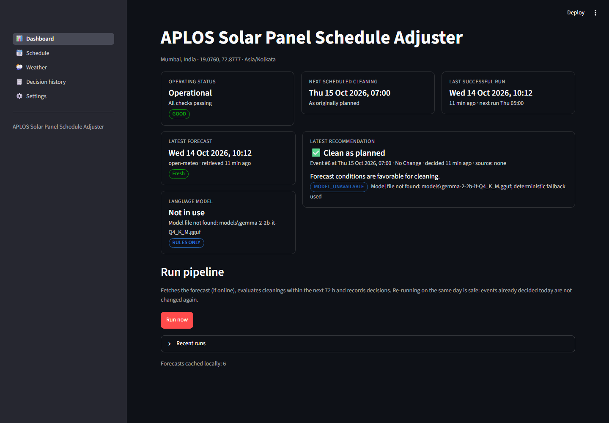
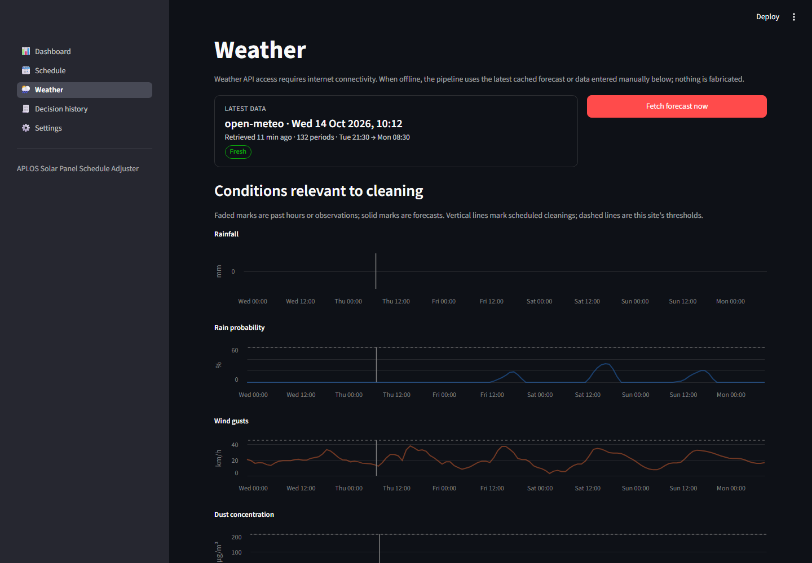
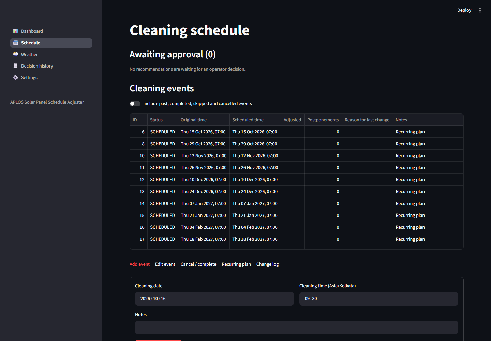
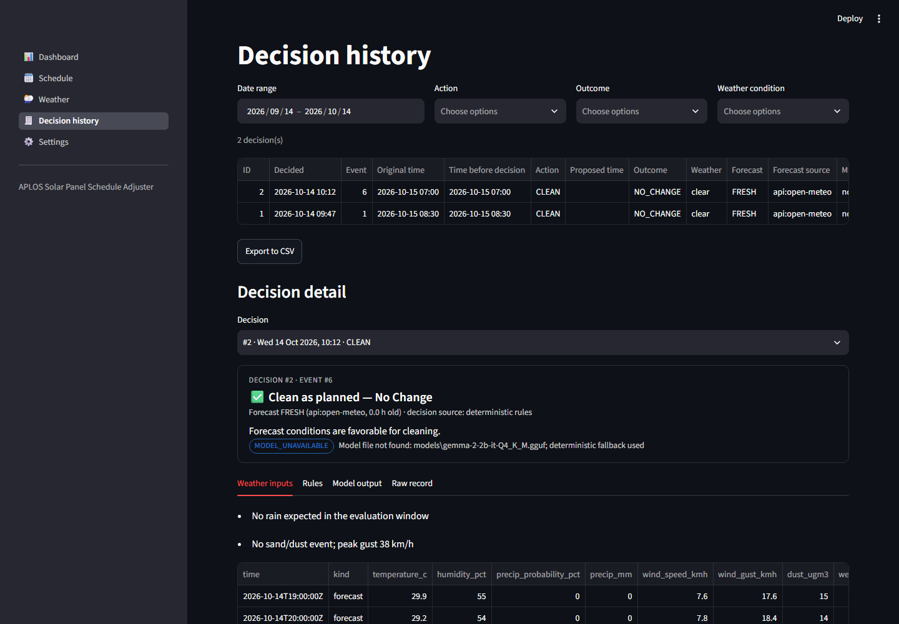

# APLOS Solar Panel Schedule Adjuster

Offline-first Python pipeline that decides, once a day, whether each upcoming
solar panel cleaning should **CLEAN** as planned, be **POSTPONE**d, or be
**SKIP**ped because rain or a sand/dust event would prevent the cleaning or
soon undo it.

Decisions combine a deterministic rules engine (authoritative) with an optional
locally hosted **Gemma 2B** model (llama.cpp) that interprets the conditions and
explains its recommendation. Schedules, cached forecasts, configuration and the
full decision history are stored locally in SQLite. A Streamlit dashboard is
provided for operators.



| Weather | Schedule | Decision history |
|---|---|---|
|  |  |  |

> **Connectivity.** Model inference and all decision-making run locally and no
> forecast data is sent to a cloud LLM. Retrieving forecasts from a weather API
> still requires internet access. When offline, the system uses the latest cached
> forecast or weather data entered manually, flags it as cached or stale, and makes
> no automatic change when no trustworthy data exists.

---

## Contents

1. [Quick start](#quick-start)
2. [Project structure](#project-structure)
3. [Architecture](#architecture)
4. [Decision logic](#decision-logic)
5. [Installing the local Gemma 2B model](#installing-the-local-gemma-2b-model)
6. [Weather API configuration](#weather-api-configuration)
7. [Daily execution](#daily-execution)
8. [Dashboard](#dashboard)
9. [Command-line reference](#command-line-reference)
10. [Testing](#testing)
11. [Simulation and evaluation](#simulation-and-evaluation)
12. [Features and limitations](#features-and-limitations)
13. [Troubleshooting](#troubleshooting)

---

## Quick start

Requires Python 3.11+.

**Windows (PowerShell)**

```powershell
cd aplos-solar-panel-schedule-adjuster
powershell -ExecutionPolicy Bypass -File scripts\setup.ps1
.\.venv\Scripts\python -m aplos seed-schedule --count 6 --interval 14 --time 07:00
.\.venv\Scripts\python -m aplos run-now
.\.venv\Scripts\streamlit run app.py
```

**Linux / macOS**

```bash
cd aplos-solar-panel-schedule-adjuster
sh scripts/setup.sh
.venv/bin/python -m aplos seed-schedule --count 6 --interval 14 --time 07:00
.venv/bin/python -m aplos run-now
.venv/bin/streamlit run app.py
```

Manual equivalent of the setup script:

```bash
python -m venv .venv
.venv/bin/pip install -r requirements-dev.txt        # Windows: .venv\Scripts\pip
cp .env.example .env
.venv/bin/python -m aplos init-db
```

The dashboard opens at <http://localhost:8501>. Without a model file the system
runs with deterministic rules only and says so on screen.

## Project structure

```
app.py                      Streamlit dashboard entry point
aplos/
  config/                   settings schema (pydantic) and environment/secrets handling
  database/                 SQLite connection, migrations, repositories
  weather/                  providers (Open-Meteo, OpenWeatherMap, mock), validation, offline cache
  llm/                      prompts, output schema, llama.cpp + mock backends, advisor (timeouts, retries)
  engine/                   rules engine, reconciliation with model output, pipeline orchestration
  scheduler/                schedule management (edits, approvals) and the daily job
  simulation/               SIMULATION ONLY: scenario generator and evaluator
  ui/                       dashboard pages
  cli.py                    `python -m aplos ...`
  models.py                 shared domain models
scripts/                    setup, model download, OS scheduler installers, wrappers
simulation/datasets/        labelled scenario datasets
reports/                    evaluation reports
tests/                      automated tests (pytest)
models/                     local GGUF model files (git-ignored)
data/, logs/                SQLite database and JSON-lines logs (git-ignored)
```

Production code never imports `aplos.simulation`. The mock weather provider and
the mock LLM backend are development tools: their output is labelled `mock` in
every record and in the UI. Mock weather data is never applied automatically.

## Architecture

```
            ┌──────────────┐   fetch (internet)   ┌───────────────────┐
 daily job ─►   Pipeline   ├─────────────────────►  Weather provider  │
 / run-now  │ (engine/)    │◄── validated bundle ─┤ Open-Meteo / OWM  │
            │              │                      └───────────────────┘
            │  1 forecast  │── on failure ─► SQLite cache (latest API or manual data)
            │  2 rules     │── allowed actions, safe reschedule slot, limits
            │  3 model     │── Gemma 2B via llama.cpp (local) → JSON → schema validation
            │  4 reconcile │── rules always win; model chooses only within allowed actions
            │  5 apply     │── atomic: decision row + schedule change (or pending approval)
            └──────┬───────┘
                   ▼
        SQLite: cleaning_events, event_changes, forecasts, decisions, job_runs, settings
                   ▲
          Streamlit dashboard (reads/edits the same database)
```

Key properties:

- **Idempotent.** A unique constraint allows one automatic decision per event
  per site-local day. Re-running the pipeline the same day changes nothing.
- **Single run at a time.** A partial unique index on `job_runs` acts as a run
  lock. A crashed run's lock is released after `lock_timeout_minutes`.
- **Atomic updates.** Recording a decision and changing the schedule happen in
  one transaction. Events use optimistic locking (`version`), so stale approvals
  are refused with a `CONFLICT` outcome.
- **Auditable.** Each decision stores the event state, the forecast window used,
  the settings in force, the rules triggered, the raw model output, the final
  action and its outcome. Every schedule change is logged in `event_changes`.
- **Restart-safe.** All state is in SQLite, and the daemon re-reads settings on each tick.

## Decision logic

For each scheduled cleaning within the evaluation horizon (default 72 h), the
rules engine checks a window from `pre_window_hours` before the cleaning to
`post_window_hours` after it ends:

| Rule | Condition (defaults, all configurable) | Result |
|---|---|---|
| R1 | Heavy rain ≥ 10 mm in window at ≥ 60 % probability | **SKIP** (panels rinsed), POSTPONE also allowed |
| R2 | Rain ≥ 2 mm at ≥ 60 % that is not dried out (12 h buffer) before cleaning | **POSTPONE** after rain + buffer, SKIP also allowed |
| R3 | Marginal rain signal (some rain, 40–60 % or ≥ 2 mm at low probability) | **CLEAN**, model may choose POSTPONE |
| S1 | Sand/dust during or after cleaning (+6 h settle): provider dust code, dust ≥ 200 µg/m³, or gusts ≥ 45 km/h when no dust data | **POSTPONE** |
| L1/L2 | Already postponed 3× or no clear slot within 120 h of the original time | POSTPONE removed; rain → SKIP, otherwise CLEAN, flagged for review |
| — | Forecast unavailable, older than 48 h, or covering < 80 % of the window | **UNDETERMINED**, no change |

Postponement slots are searched forward hour by hour. A slot is accepted only
inside the site's cleaning hours and only when its own window is clear.

**Model role.** The model receives the forecast (in 3-hour blocks), the planned
time, the site rules, the rule findings and the list of allowed actions. It must
return JSON:

```json
{"action": "POSTPONE", "reason": "…", "conditions": ["…"], "confidence": 0.8,
 "next_cleaning_time": "2026-03-12T06:00"}
```

Output is generated under a JSON grammar (when llama.cpp supports it) and is
always validated against a pydantic schema. One retry is made on invalid output.
Reconciliation then applies these checks:

- an action outside `allowed_actions` is overridden (`MODEL_OVERRIDDEN`);
- confidence below `min_model_confidence` is ignored;
- a proposed time is used only if it falls within the postponement limits and
  the cleaning hours and the forecast is clear at that time; otherwise the rules
  engine's slot is used;
- a timeout, missing model or invalid JSON falls back to the deterministic decision (`MODEL_UNAVAILABLE`).

**Automation gate.** POSTPONE/SKIP decisions are applied automatically when
`auto_apply` is on and the forecast is fresh or cached. A stale forecast (when
`auto_apply_on_stale` is off), mock data, or disabled automation leaves the
recommendation in **Awaiting approval**. An operator can then approve it, which
applies the change, or reject it.

The deterministic confidence value is a heuristic based on rain probability,
the sand indicator type and forecast coverage. Treat it as a relative indicator,
not a calibrated probability.

## Installing the local Gemma 2B model

**Hardware.** Gemma 2 2B instruct at Q4_K_M quantisation (~1.7 GB file) needs
about 3 GB of free RAM and a 64-bit CPU with AVX2. On a typical 4–8 core laptop CPU
one recommendation (about 1,000 prompt tokens and 150 output tokens) takes roughly
10–60 s. The default timeout is 90 s, which can be changed in Settings → Local
model. A GPU is optional; setting `n_gpu_layers = -1` requires a CUDA- or
Metal-enabled llama-cpp-python build.

1. **Install llama-cpp-python** (a prebuilt CPU wheel, no compiler needed):

   ```bash
   .venv/bin/pip install -r requirements-llm.txt --extra-index-url https://abetlen.github.io/llama-cpp-python/whl/cpu
   ```

   Windows: use `.venv\Scripts\pip`. Building from source instead requires a
   C/C++ toolchain (Visual Studio Build Tools on Windows).

2. **Download a Gemma 2 2B instruct GGUF.** Gemma is released under Google's
   Gemma Terms of Use. Review and accept them, and log in with
   `huggingface-cli login` if the repository requires it.

   ```bash
   .venv/bin/pip install huggingface_hub
   .venv/bin/python scripts/download_model.py
   ```

   This saves `models/gemma-2-2b-it-Q4_K_M.gguf`. Any Gemma 2B instruct GGUF
   works; set its path in `.env` (`APLOS_MODEL_PATH=...`) or in Settings → Local model.

3. **Verify:**

   ```bash
   .venv/bin/python -m aplos check-model --generate
   ```

   This reports whether the file and library are present, loads the model and
   runs a test inference. The dashboard shows **Gemma 2B (local)** only after the
   model has been verified as available. Otherwise it shows **RULES ONLY**. The
   mock backend (`mode = mock`) is never substituted for a missing model.

## Weather API configuration

| Provider | Key | Notes |
|---|---|---|
| **Open-Meteo** (default) | none | Hourly rain amount/probability, wind, gusts, temperature, humidity, plus CAMS dust concentration from the air-quality API. Past hours are model estimates and are labelled as such. |
| **OpenWeatherMap** | `OPENWEATHER_API_KEY` | 5-day / 3-hour forecast; dust/sand condition codes 731/751/761 are used as sand indicators. |
| **Mock** | none | Synthetic development data (`clear`, `rain`, `heavy_rain`, `sand`, `mixed`). Never applied automatically. |

Set the provider, timeout, retries and forecast length in Settings → Weather API.
API keys are read from the environment or `.env` and are never written to the
database. Saving a key from the dashboard writes it to the local `.env` file.

Robustness:

- **Timeouts and failures.** Timeouts, connection errors and HTTP 429/5xx are retried with backoff.
- **Validation.** Out-of-range values are dropped with a warning, and duplicates
  and gaps are detected. Forecasts without future periods or precipitation data
  are rejected.
- **Caching and freshness.** Each valid forecast is cached. A failed fetch falls
  back to the latest cached API or manual data, labelled `CACHED`, then `STALE`
  (over 12 h), then unusable (over 48 h).
- **Reconnection.** The API is retried on every run, so service resumes
  automatically when connectivity returns.

**Manual data.** Use the Weather page to enter or upload hourly values (CSV
columns `local_time, rain_mm, rain_probability_pct, wind_gust_kmh, dust_ugm3,
temperature_c, humidity_pct`). Mark them as either forecasts or on-site observations.

## Daily execution

Configure in Settings → Site & schedule: site location, time zone, daily run time
(default 05:00 local), cleaning hours, cleaning duration and evaluation horizon.

Run the daemon:

```bash
.venv/bin/python -m aplos scheduler          # checks every 60 s
```

- It runs once the configured local time is reached, and at most once per day after a success.
- **Catch-up.** If the machine was off at run time, it runs as soon as it starts
  (trigger `catchup`).
- **Retries.** Failed runs are retried after 30 min, up to 3 attempts per day.
- **Crash recovery.** A run lock left by a crash is released after
  `lock_timeout_minutes` (default 30).
- **Missed days.** Earlier missed days are logged but not replayed, because
  decisions concern upcoming cleanings.
- **Rolling plan.** With *Keep the recurring plan filled automatically* on
  (Settings → Site & schedule), each run adds cleanings so the plan always
  reaches `plan_horizon_days` (default 183) ahead. New cleanings continue the
  cycle from the latest originally planned date at the default interval, so
  postponements don't shift the cycle and cancelled cleanings aren't recreated.
  Editing an event's time resets its original time, which moves the cycle.

Start it automatically:

- **Windows:** `powershell -ExecutionPolicy Bypass -File scripts\install_windows_task.ps1`
  registers a Task Scheduler task that starts the daemon at logon and restarts it
  if it stops. Remove it with `-Remove`.
- **Linux:** `sh scripts/install_systemd_service.sh` installs a systemd user
  service. Alternatively, use cron with
  `@reboot cd /path/to/project && .venv/bin/python -m aplos scheduler`.
- **External scheduler:** call `python -m aplos scheduler --once` periodically.
  It runs only when due.

Each execution is logged in the `job_runs` table (trigger, status, duration,
counts, errors) and in `logs/aplos.log` (JSON lines).

## Dashboard

`streamlit run app.py`

- **Dashboard:** operating status, next cleaning (original and adjusted), latest
  recommendation with its explanation and flags, forecast freshness and
  timestamp, model status, last successful run, a run-now button and recent runs.
- **Schedule:** approve or reject pending recommendations (the reviewer is
  recorded); upcoming events with original/adjusted times and reasons; add, edit,
  cancel or complete events; create recurring plans; change log.
- **Weather:** rainfall, rain probability, gusts and dust charts with thresholds
  and cleaning times. Past hours and observations are visually distinct from
  forecasts. Also shows retrieval time and warnings, a fetch-now button, and
  manual data entry or CSV upload.
- **Decision history:** filter by date, action, outcome and weather condition;
  export to CSV; per-decision view of weather inputs, rules, model output and the raw record.
- **Settings:** site and time zone, daily run time, rule thresholds, postponement
  limits, weather provider and API key, model path and inference settings, automation switches.

## Command-line reference

```
python -m aplos init-db                      create/migrate the database
python -m aplos run-now [--mock-weather S]   run the pipeline immediately
python -m aplos scheduler [--once] [--poll N]
python -m aplos fetch-weather                fetch and cache a forecast
python -m aplos check-model [--path P] [--generate]
python -m aplos seed-schedule --start YYYY-MM-DD --count N --interval D --time HH:MM
python -m aplos status
python -m aplos simulate [--generate] [--weeks 5] [--seed 42] [--llm disabled|mock|local]
```

## Testing

```bash
.venv/bin/python -m pytest
```

The 107 tests cover:

- rain, heavy rain and sand/dust before or after cleaning;
- favorable weather and marginal rain;
- thresholds and wind proxy settings;
- postponement count and time limits, and slot search;
- missing, stale and insufficient forecasts;
- API timeouts and HTTP errors;
- unavailable model, invalid JSON and model timeouts;
- model output that conflicts with the rules, and permitted model alternatives;
- offline cache use and reconnection;
- configurable run times and time zones;
- duplicate execution prevention, same-day idempotency and crash recovery with catch-up;
- retries, approvals, rejections, conflicts and superseded recommendations;
- decision history, rolling plan extension, the CLI and headless dashboard rendering (Streamlit AppTest).

## Simulation and evaluation

```bash
.venv/bin/python -m aplos simulate --generate      # rules only
.venv/bin/python -m aplos simulate --llm local     # with the local model, once installed
```

The synthetic dataset (`simulation/datasets/synthetic_5_weeks.json`) has 5 weeks
× 3 scenarios per day = 105 cleanings. For each scenario the generator first
simulates the **realized** weather, then derives the **forecast** the pipeline
sees by adding forecast errors: timing shifts, amount errors, missed events and
false alarms. The label is the hindsight-correct action computed from the
realized weather by an independent labelling policy recorded in the dataset
metadata. Every scenario is replayed through the production pipeline in an
isolated in-memory database.

Reports are written to `reports/evaluation_report.md` / `.json`, with
per-scenario rows in `evaluation_scenarios.csv`. They cover:

- total scenarios evaluated and correct decisions;
- accuracy as a percentage;
- results by rain and sand events;
- false and missed postponements, and wrong adjustment types;
- a confusion matrix.

**Current result** (deterministic rules only; no model installed in this environment):

| Metric | Value |
|---|---|
| Scenarios | 105 |
| Correct | 84 (80.0 %) |
| Rain events | 22 / 32 (68.8 %) |
| Sand/dust events | 16 / 19 (84.2 %) |
| No event | 51 / 59 (86.4 %) |
| False postponements | 8 |
| Missed postponements | 11 |

The original workshop implementation achieved **86 %** correct schedule
adjustments over a five-week field test. That is a historical benchmark. The
80.0 % above is measured on synthetic data, where the misses come from simulated
forecast errors, and the two figures are not directly comparable. To evaluate on
real history, build a dataset in the same JSON format: archived forecasts as
issued, plus labels derived from observed rain-gauge and dust data. Then run
`python -m aplos simulate --dataset path/to/file.json`.

## Features and limitations

**Implemented**

- Weather ingestion from Open-Meteo (including dust) and OpenWeatherMap through
  a modular provider interface, plus a mock provider and manual/CSV input.
- Validation, retries and timeouts, a local cache and freshness classification.
- Deterministic rules engine with configurable thresholds, windows, buffers and
  limits, plus a forward slot search.
- Local Gemma 2B integration (llama.cpp, JSON grammar, schema validation,
  timeout, retry), a clearly labelled mock backend, and a deterministic fallback.
- Reconciliation in which hard constraints always win; flags record each
  override and fallback.
- Idempotent, locked, atomic pipeline with a full audit trail and an event change log.
- Daily daemon with catch-up, retries, crash recovery, and installers for
  Windows Task Scheduler and systemd.
- Streamlit dashboard with operator approvals, schedule editing, weather charts,
  history filters, CSV export and settings.
- Simulation dataset generator, evaluator and reports.

**Limitations and remaining setup**

- **Model not installed here.** The Gemma model file and llama-cpp-python were
  not installed in this environment, so live model inference has not been
  exercised. The integration is covered by interface tests with scripted and
  mock backends. Install with the steps above, then run `check-model --generate`.
- **No accuracy figure with the model yet.** The evaluation above uses rules
  only. Run `simulate --llm local` after installing the model.
- **Internet needed for API forecasts.** Weather APIs require connectivity;
  offline operation relies on cached or manual data.
- **Dust data limits.** Open-Meteo's dust values are CAMS model estimates. Where
  dust data is missing, strong gusts are used as a proxy for sand risk.
- **Single site.** One site per installation (one database). Run separate
  instances for multiple sites.
- **Heuristic confidence.** The deterministic confidence score is a heuristic, not a calibrated probability.
- **Synthetic labels.** Synthetic dataset labels follow the default policy. If
  you change site thresholds, regenerate or relabel the dataset.

## Troubleshooting

| Symptom | Fix |
|---|---|
| Dashboard shows **RULES ONLY** | Run `python -m aplos check-model`: it reports a missing file, missing llama-cpp-python, or a load error. |
| `Weather API unreachable` | The machine is offline. Decisions use the cache (flagged), or enter data on the Weather page. |
| `Weather API rejected credentials` | Check `OPENWEATHER_API_KEY` in `.env` or switch to Open-Meteo. |
| Recommendations stay *Awaiting approval* | Automation is off, the forecast is stale, or mock data is in use. Check Settings → Automation. |
| Daily job did not run | Check that the scheduler task/service is running and review `logs/aplos.log` and Dashboard → Recent runs. Runs are retried 3× per day. |
| `Another pipeline run is in progress` | A run is active or crashed. The lock is released automatically after `lock_timeout_minutes`. |
| Model inference times out | Raise the timeout or lower `max_tokens` in Settings → Local model, set `n_threads` to your physical core count, or use a smaller quantisation. |
| `Unknown time zone` on Windows | Reinstall dependencies; `tzdata` provides the zone database. |
